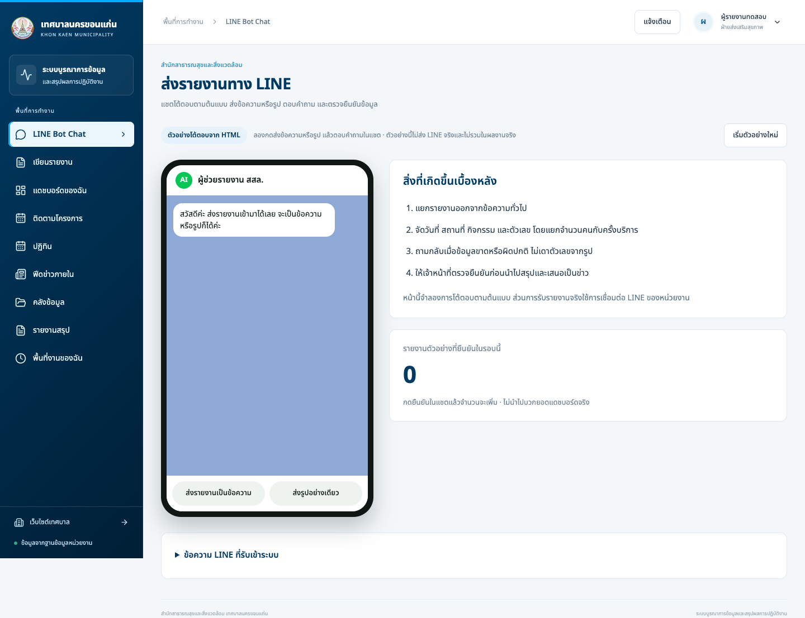
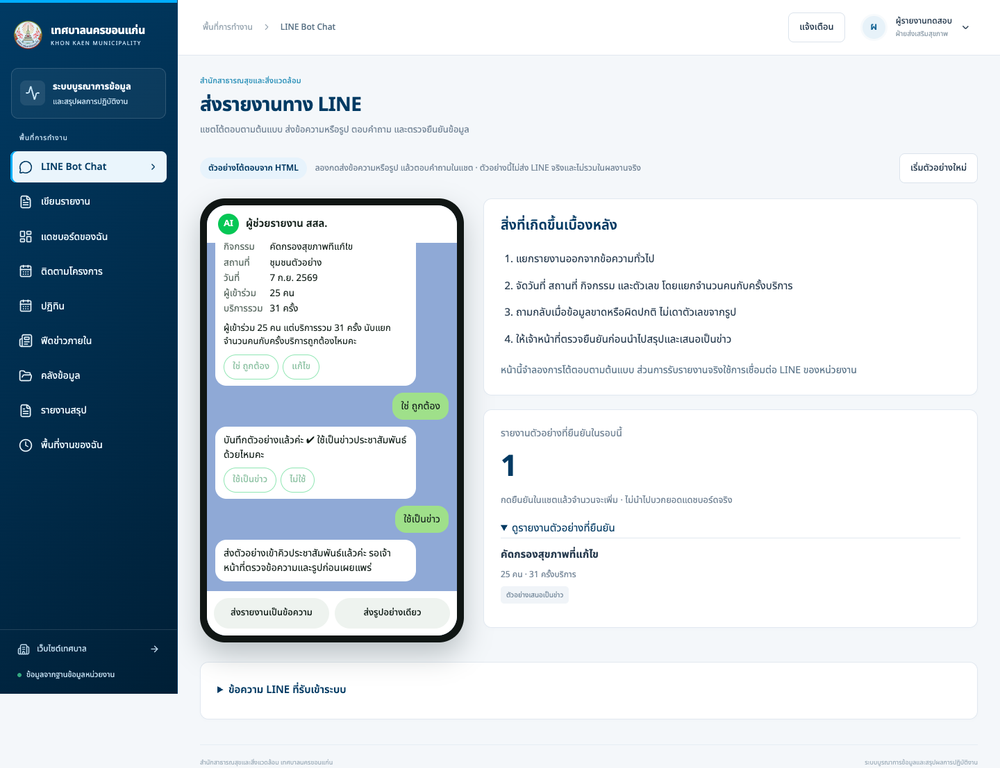
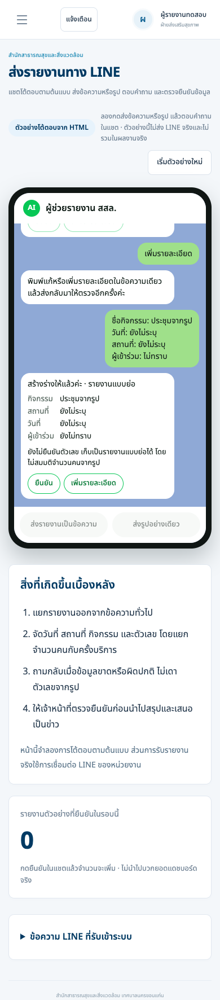

# LINE Bot Chat ตาม HTML ต้นแบบ

เมนู **รายงานจาก LINE** เปลี่ยนเป็น **LINE Bot Chat** ที่ `#inbox` ใช้หน้าตาโทรศัพท์และลำดับโต้ตอบจาก `e-office-สำนักสาธารณสุขและสิ่งแวดล้อม-ต้นแบบ.html` ของผู้ใช้

## ลองใช้งาน

1. กด **ส่งรายงานเป็นข้อความ** → อ่านสรุป → **ใช่ ถูกต้อง** หรือ **แก้ไข** ข้อความในช่องเดียว
2. หรือกด **ส่งรูปอย่างเดียว** → เลือกกิจกรรม → ระบุจำนวนโดยประมาณหรือไม่ทราบ → **ยืนยัน** หรือ **เพิ่มรายละเอียด**
3. เมื่อยืนยัน ตัวนับรายงานตัวอย่างเพิ่มหนึ่งครั้ง แล้วเลือก **ใช้เป็นข่าว** / **ไม่ใช้** ได้
4. กด **เริ่มตัวอย่างใหม่** เพื่อล้างบทสนทนาและตัวนับของรอบนี้
5. เปิด **ข้อความ LINE ที่รับเข้าระบบ** ด้านล่าง เพื่อใช้รายการรับเข้าจริงและขั้นตอนจัดรายงานเดิมตามสิทธิ์

แชตนี้เป็นตัวอย่างโต้ตอบในเบราว์เซอร์ตาม HTML: ใช้ข้อความและช่องรูปตัวอย่าง ไม่ส่ง LINE ไม่เรียก AI/OCR และไม่เขียนรายงาน ข่าว หรือไฟล์ลงฐานข้อมูล การแก้ข้อความอ่านเฉพาะหัวข้อที่ระบุในตัวอย่าง ไม่ใช่การสกัดภาษาธรรมชาติ ข้อมูลหายหรือจำนวนโดยประมาณยังแสดงว่ายังไม่ยืนยัน ไม่สมมติจำนวนคนจากภาพ ตัวนับเริ่มใหม่เมื่อออกจากหน้านี้หรือรีเฟรช

การรับ LINE จริงยังใช้ webhook และการตั้งค่าเดิมของหน่วยงาน ไม่เปลี่ยนสิทธิ์เข้าถึงข้อมูล

## หลักฐานการตรวจ

- `npm run build` ผ่าน
- `npm run test:line-bot` ผ่าน: ข้อความ รูป แก้รายละเอียด ยืนยัน เลือกข่าว เริ่มใหม่ ยกเลิกคำตอบที่กำลังรอ และไม่มีการเขียนข้อมูลจริง
- `npm run test:usability` ผ่าน: เส้นทางเมนูเดิมและกล่องข้อความ LINE เดิม
- ตรวจภาพเดสก์ท็อปและมือถือ พร้อมทดสอบไม่มีหน้าล้นแนวนอน

